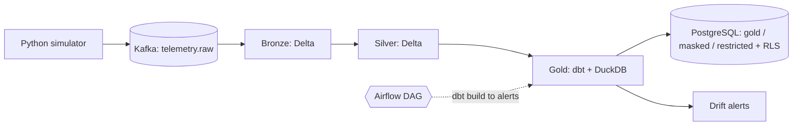
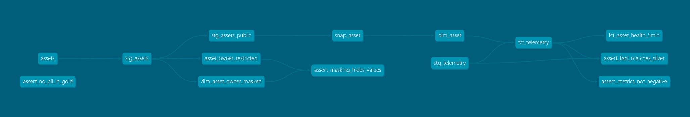

# Enterprise Asset & Network Health Data Platform


An end-to-end data platform for monitoring the health of telecom network devices and industrial equipment across several clients, and for flagging degrading assets before they fail. It covers ingestion, a Medallion lakehouse, a dbt star schema with history tracking, privacy controls with row-level security, orchestration and a statistical early-warning model.

> **All data is synthetic.** Names and emails are generated with Faker, and telemetry comes from a Python simulator that injects faults, duplicates and sensor errors on purpose. Results below show that the pipeline and the evaluation work. They are not accuracy claims for real equipment.

## Architecture





| Layer | Tooling | What it does |
|---|---|---|
| Simulator | Python, Faker | 60 assets, 3 clients, 12,000 readings, plus 129 duplicate messages, about 3% corrupted readings, and 6 injected degrading faults |
| Ingestion | Kafka (KRaft) | 3-partition topic keyed by `asset_id`, so each asset's readings stay ordered |
| Bronze | PySpark Structured Streaming, Delta Lake | Raw messages kept as received, with Kafka partition, offset and ingest time; checkpointed |
| Silver | PySpark, Delta Lake | Schema enforcement, de-duplication on `event_id`, `-999` sentinels turned into nulls and flagged, invalid rows quarantined, quality report |
| Gold | dbt-duckdb | Star schema, SCD Type 2 snapshot, point-in-time join, 5-minute health aggregates, 27 dbt checks |
| Governance | dbt, PostgreSQL | PII split into restricted and masked tables, governance tests, roles, grants and row-level security |
| Orchestration | Airflow | DAG: `dbt build` → audit log → publish to Postgres → RBAC → alerts |
| ML | pandas, DuckDB | Rolling-window drift detection against each asset's own healthy baseline |
| CI | GitHub Actions | Syntax check, simulator checks, `dbt parse`, compose validation |

## Verified results

| Check | Result |
|---|---|
| Bronze rows | 12,129 |
| Silver rows | 12,000 (129 duplicates removed, 0 quarantined, 165 rows with a sensor error) |
| Gold rows | `dim_asset` 62, `fct_telemetry` 12,000, `fct_asset_health_5min` 480 |
| `dbt build` | 27 / 27 pass (1 seed, 1 snapshot, 8 models, 17 tests) |
| Fact table vs Silver | Row counts match, enforced by a dbt test |

### Slowly changing dimension (SCD Type 2)

Two assets were moved to a new site to exercise the snapshot. Each now has two versions, the old one closed and the new one open. Telemetry is joined to the asset version that was valid at the time of the reading, so history is not rewritten.

### Privacy and access control

Owner names and emails are kept out of every Gold table, and a dbt test fails the build if a PII column appears in one. The restricted table holds the raw values and the masked table holds masked values plus a salted pseudonymous id. Gold is published to PostgreSQL, where the access tests gave:

| Role | Result |
|---|---|
| TelcoCo user | 4,600 rows, TelcoCo only; `masked` schema denied |
| EnergyCo user | 2,200 rows, EnergyCo only |
| Analyst | all 3 clients (2,200 / 5,200 / 4,600), 60 masked rows; `restricted` denied |
| Governance | 60 restricted rows |

The raw test output is in [`docs/rbac_test_output.txt`](docs/rbac_test_output.txt).

### Early-warning detection

Faults are gradual drifts, not spikes. For each asset, a 10-reading rolling mean is compared with that asset's own healthy baseline (its first 25% of readings), in standard deviations. The alert threshold of 2.0 was picked from stress tests (seeds 1-5, then 101-120) and then confirmed on fresh seeds.

On the main dataset the 6 injected faults were all caught with 0 false alarms among 54 healthy assets. Alerts came 9 to 11 readings (about 1.5 to 2 minutes) after the fault began.

Stress test, threshold 2.0, seeds 101-120 (60 faults per row, split evenly between telecom and industrial assets):

| Fault strength (1.0 = original) | Telecom recall | Industrial recall | False-alarm rate | Median delay (readings) |
|---|---|---|---|---|
| 1.0 | 1.00 | 1.00 | 0.00 | 11 |
| 0.5 | 1.00 | 1.00 | 0.00 | 17 |
| 0.25 | 1.00 | 1.00 | 0.00 | 27.5 |
| 0.10 | 1.00 | 0.82 | 0.00 | 52 |

A rate of 0.00 means below 0.5%, not a proven zero.

## Known limitations

- The simulator and the evaluation share the same generating assumptions, so detection numbers are optimistic compared with real equipment.
- In the main run all 6 faulty assets are network devices. Industrial assets are covered by the stress test only, where very slow faults (strength 0.10) are missed about 18% of the time. A change-point method such as CUSUM is the natural next step. A trained model was not added because the statistical baseline already detected everything down to a quarter of the original fault strength.
- Kafka and Spark are run by hand with `docker compose run`. The Airflow DAG starts from the Silver table so that Airflow does not need access to the Docker socket.
- Gold is built with DuckDB for simplicity. The SQL and tests are portable to Spark or Fabric.
- The PostgreSQL users are `NOLOGIN` roles tested with `SET ROLE`. A real deployment would use login roles with credentials from a secrets manager or SSO.
- The first Airflow test run needed one automatic retry. The cause was not identified. A second run passed without a retry.
- CI covers syntax, simulator output, `dbt parse` and compose validation. It does not run Kafka, Spark or the DAG.

## Run it

Requirements: Docker Desktop, Python 3.11. On Git Bash for Windows, prefix `docker exec` and `docker compose run` commands with `MSYS_NO_PATHCONV=1`.

```bash
cp .env.example .env            # then set PG_ADMIN_PASSWORD to a long random value
python -m venv .venv && source .venv/Scripts/activate
pip install -r requirements.txt

docker compose up -d
python simulator/assets.py && python simulator/telemetry.py
docker exec kafka /opt/kafka/bin/kafka-topics.sh --create --topic telemetry.raw \
  --bootstrap-server localhost:9092 --partitions 3 --replication-factor 1
python ingestion/kafka/producer.py

# Bronze and Silver (Spark in Docker)
docker compose run --rm spark /opt/spark/bin/spark-submit \
  --packages org.apache.spark:spark-sql-kafka-0-10_2.12:3.5.3,io.delta:delta-spark_2.12:3.2.0 \
  /app/spark/bronze/bronze_stream.py
docker compose run --rm spark /opt/spark/bin/spark-submit \
  --packages io.delta:delta-spark_2.12:3.2.0 /app/spark/silver/silver_telemetry.py

# Gold, governance, alerts
cd dbt && export DBT_PROFILES_DIR=. && dbt build && cd ..
python governance/audit_run.py
python governance/publish_to_postgres.py
docker exec -i postgres psql -U admin -d assethealth -v ON_ERROR_STOP=1 < governance/rbac.sql
python ml/generate_alerts.py
```

Or run everything from `dbt build` onward through Airflow:

```bash
docker compose -f docker-compose.yml -f docker-compose.airflow.yml up -d --build airflow
docker exec airflow airflow dags test asset_health_gold_to_alerts
```

## Repository layout

```
simulator/      synthetic assets and telemetry, fault injection
ingestion/      Kafka producer
spark/          Bronze streaming job, Silver cleaning job
dbt/            staging, marts, governance models, snapshot, tests
governance/     audit log, Postgres publish, RBAC and RLS SQL
ml/             drift scoring, early-warning evaluation, stress test, alert generation
airflow/        Dockerfile and DAG
tests/          simulator and environment checks
docs/           lineage graph, RBAC test output
```
